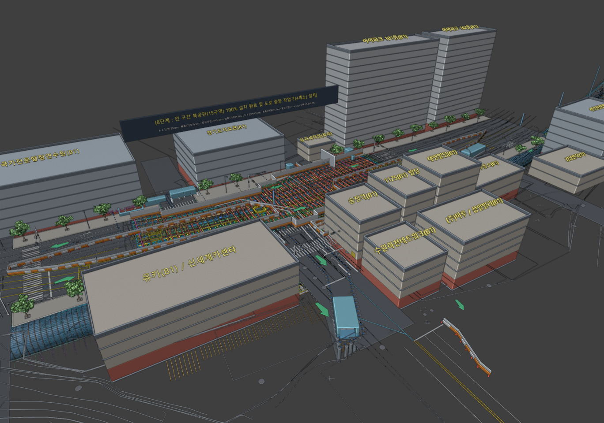
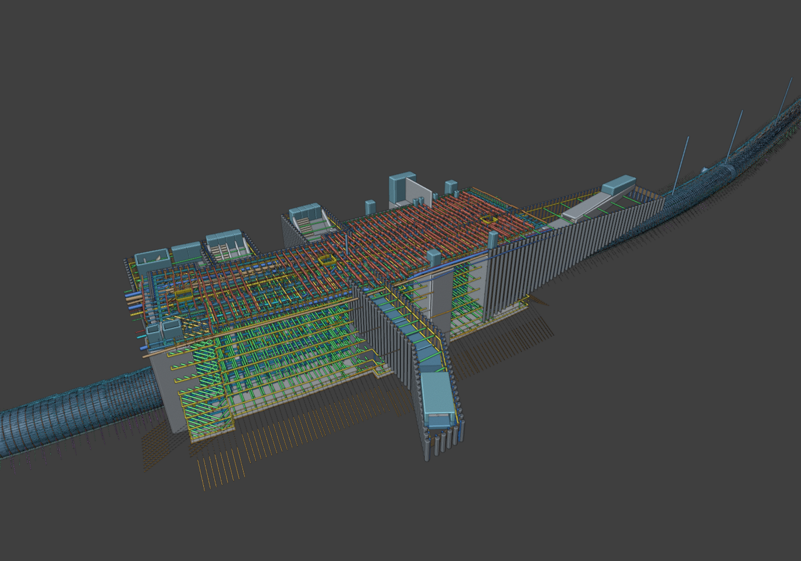
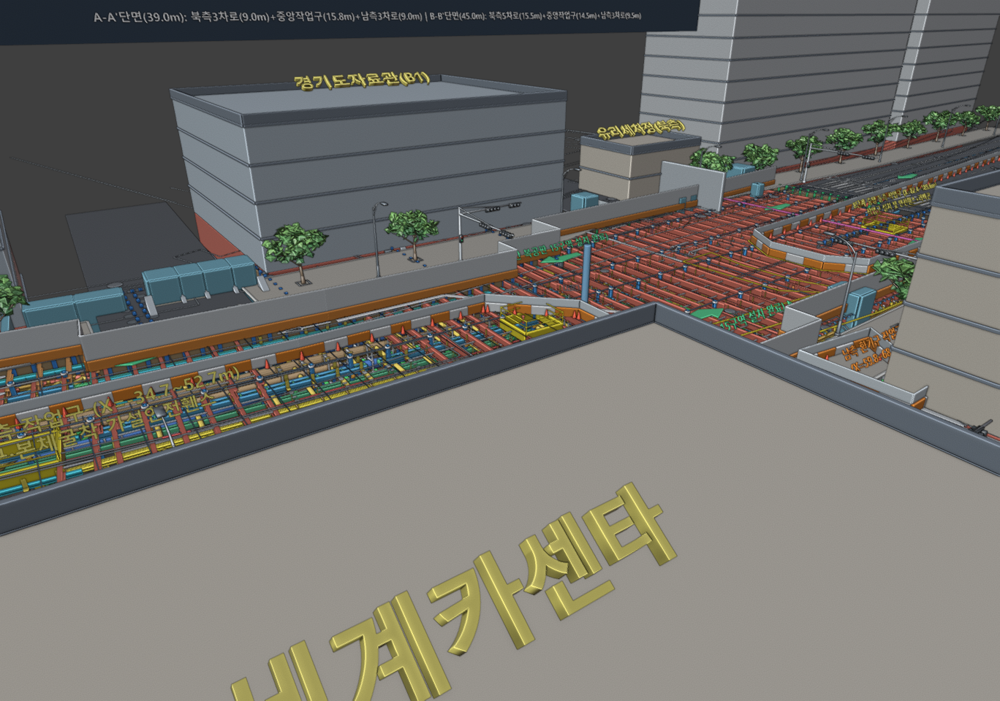
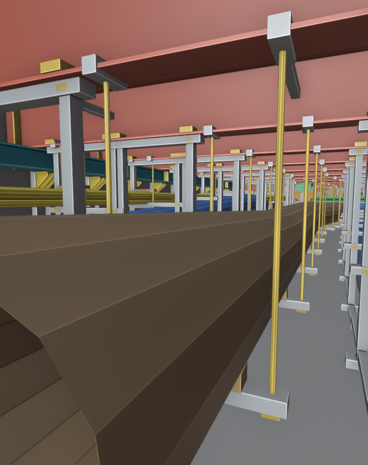
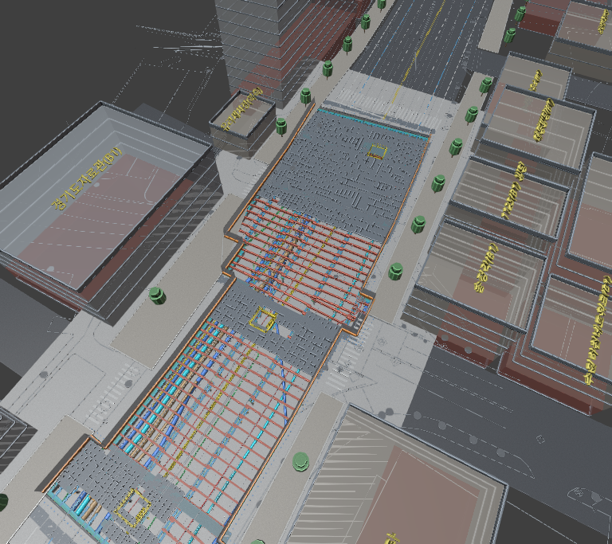
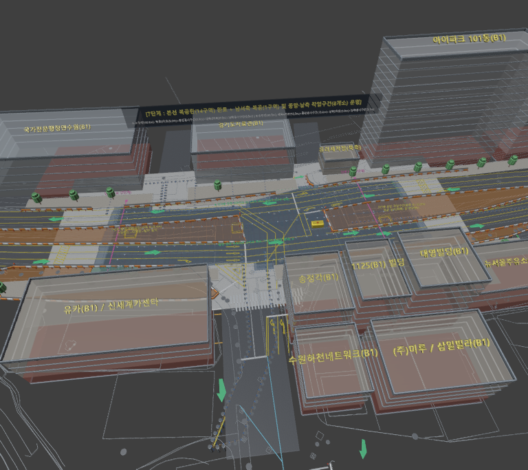
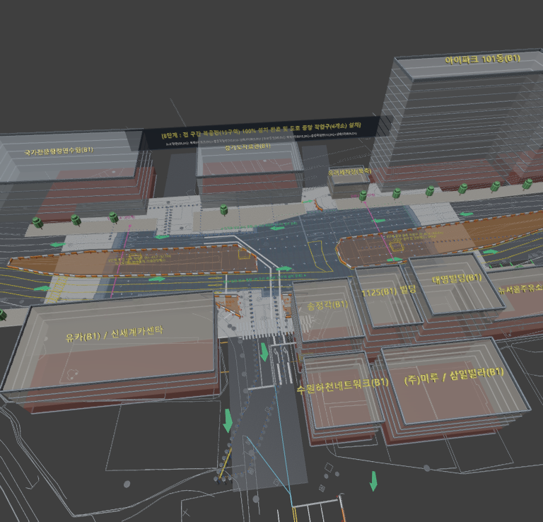

# 인덕원~동탄 복선전철 제5공구 노반신설 기타공사 3D/4D BIM 통합 성과물 (106정거장 및 본선터널)

본 저장소는 **인덕원~동탄 복선전철 제5공구(106정거장 개착 가시설·본체 구조물 및 본선 NATM 터널)** 실시설계 및 설계변경(원가개선 VE) 도면을 기반으로 Blender 5.2 환경에서 1:1 정밀 좌표로 구축한 **3D/4D 시공 BIM 통합 모델 및 자동화 파이썬 스크립트 성과물**입니다.

---

## 1. 주요 구현 성과물 요약

| 구분 | 컬렉션명 / 스크립트 | 주요 구현 내용 및 엔지니어링 제원 |
| :--- | :--- | :--- |
| **① 본선터널·환기구 철근배근 및 배수계통 (LOD400)** | `18_본선터널_...` ~ `20_...`<br>[`01_build_detailed_tunnel_rebar.py`](scripts/01_build_detailed_tunnel_rebar.py) | • 본선 NATM 터널(Type-1, Type-5, 확폭구간, 기재갱) 내·외측 주철근(H16~H29), 배력근, 전단보강근(스터럽)<br>• S007 환기구 수직구(`D=13.4m, H=40.7m`) 원형 링철근·수직근·연결터널 헌치 보강근<br>• 종·횡방향 맹암거(`Ø100`, `Ø300`), 집수정(Sump Pit), 정화조, 배수맨홀 및 오·배수관망 |
| **② 본선터널 NATM 지보재 및 단계별 굴착** | `21_본선터널_NATM지보재_...`<br>[`02_build_natm_support_and_excavation.py`](scripts/02_build_natm_support_and_excavation.py) | • 격자지보(Lattice Girder `LG-50×20×30`) 및 H형강 지보공(`H-100×100`, `H-125×125`)<br>• 시스템 록볼트(`D25, L=3.0~4.0m` 방사상 천공·정착판) 및 강관다단그라우팅(`Ø60.5/114.3mm` 우산형 보강)<br>• 1·2차 숏크리트 라이닝 및 상반(Top Heading)·하반(Bench)·인버트(Invert) 단계별 굴착 막장 |
| **③ 4D 시공 공정 시뮬레이션 (1~150 Frame)** | `22_4D공정시뮬레이션_...`<br>[`03_setup_4d_construction_bim.py`](scripts/03_setup_4d_construction_bim.py) | • 사전 지반보강·엄지말뚝 항타 ➔ 복공판·주형보 설치 ➔ 1~6단 단계별 굴착 및 버팀보 가설 ➔ 기초·B2·B1·상부 슬래브 상향 타설 및 버팀보 단계별 해체 ➔ 되메우기·도로 복구 전 과정 타임라인 연동 |
| **④ 106정거장 1차 가시설(3th 수정도) 복공·주형보·띠장 상세** | `01A_가시설_복공판_...`<br>[`04_build_cad044_decking_and_shoring_details.py`](scripts/04_build_cad044_decking_and_shoring_details.py) | • `044_01.106정거장 1차 가시설도-3th` CAD 원본 1:1 매칭<br>• 무소음 강재 복공판(`3,791매`), 주형보(`I-700×300×13×24`, `254본`), 주형지지보(`H-300×300` 더블 채널, `538개소`), 피스브라켓(`708개소`), 1~6단 띠장 및 우각부 화스너·버팀보 |
| **⑤ Mistrut 원가개선 VE (1단 버팀보 삭제 + 2·3단 Mistrut)** | `01M_가시설_Mistrut공법_...`<br>[`05_apply_mistrut_106_station.py`](scripts/05_apply_mistrut_106_station.py) | • `3_Mistrut 자료모음` 설계변경 도면(`mistrut_2_2.dxf`, `mistrut_2_3.dxf`) 반영<br>• 기존 1단 일반 버팀보 전 구간 삭제(상부 굴착·작업 공간 확보) + 2단·3단 고강성 **Mistrut(선단 삼각 트러스 사보강 일체형 버팀보)** 적용 |
| **⑥ 6대 지하매설 지장물 및 매달기·보호 가시설 (690세트)** | `01U_가시설_지장물현황_...`<br>[`06_build_cad044_utilities_and_hangers.py`](scripts/06_build_cad044_utilities_and_hangers.py) | • 광역상수도(`D2200`, `D1100`), 시상수도(`D300`), 도시가스관(`D250`, `D200`), 하수관(`D600~1200`), 통신관(`12~24공`), 한전전력관(`12공`) 총 13개 노선<br>• 주형보(`I-700×300`) 하부 플랜지(`Z=-0.90m`) 직결 **Type A(강관 매달기 296개소), Type B(통신·한전 덕트 매달기 181개소), Type C(가스관 전용 방호·매달기 213개소)** 총 `690세트` |
| **⑦ 주변 도로 현황 및 인접 건물 16개 동 (지하 B1 기초 포함)** | `02S_주변도로현황_...`<br>[`07_build_surrounding_roads_and_buildings.py`](scripts/07_build_surrounding_roads_and_buildings.py) | • CAD 현황블록(`CZDIMA125`, `8,848 entities`) 및 `106정거장 일반도` 기반 왕복 8차선 경수대로·사거리 교차로·보도·가로수·지상 맨홀(`166개소`)<br>• 국가전문행정연수원(B1), 경기도자료관(B1), 아이파크 101·102동(B1), 유카(B1), 송정각(B1), 1125(B1), 대영빌딩(B1), 뉴서울주유소(B1) 등 **16개 인접 건물 지상층 + 지하 1층(B1) 근접기초** |
| **⑧ 공사중 단계별 교통처리계획 (1단계 ~ 8단계 전체)** | `03T_단계별교통처리계획_...`<br>[`08_build_8stage_traffic_control_plan.py`](scripts/08_build_8stage_traffic_control_plan.py) | • `1. 단계별 교통처리계획.dwg`(`15,594 entities`) 기반 **1단계 ~ 8단계 전 단계 3D 교통처리계획**<br>• 단계별 기설치 복공판(`지-철판`), 금회 시공 복공판(`CE-LINE-LIN3`), 점용 작업구간(`지-안전휀스 라바콘-개선`), PE방호벽·가설안전휀스·라바콘·경광등·공사안내판, 변경 우회차선(`차선도색(변경)`) 및 단면 `A-A'`/`B-B'` 마커 |
| **⑨ 실사형 가로수·보행가로등·4현시 신호등 및 지상·지하 동시 투시(Cutaway)** | `02S_주변도로현황_...`<br>[`09_upgrade_realistic_trees_streetlamps_signals.py`](scripts/09_upgrade_realistic_trees_streetlamps_signals.py) | • 다중 분기 줄기·수관 클러스터 **실사형 가로수(30그루)**, 아치형 암·LED 헤드 **보행자 가로등(36본)**<br>• CAD 원본(`CZDIMA125`) 1:1 좌표 기반 **복합 가로형 4현시 교통신호등 갠트리(R/Y/LA/G 4색 렌즈·챙·부착형 도로명판 8기)**<br>• 고대비 Studio/Cavity SOLID 셰이딩 및 **지상(건물·가로수·신호등·교통처리) + 지하(106정거장 가시설·Mistrut·지장물·본선터널·S007 환기구) 동시 투시 Cutaway 뷰** |

---

## 2. 주요 3D BIM 뷰포트 프리뷰

### (1) 지상·지하 전 구간 동시 투시(Cutaway) 통합 뷰 (인접 건물·실사형 가로수·신호등 + 지하 106정거장·Mistrut·지장물·본선터널)


### (2) 지하 구조물 전 구간 단독 투시 뷰 (106정거장 가시설 + 2·3단 Mistrut VE + 6대 지장물 + 외부출입구 4개소 + 양방향 NATM 터널 + S007 수직구)


### (3) 지상 실사형 가로수·보행가로등·4현시 신호등 갠트리 및 지하 가시설 근접 투시 뷰


### (4) 지하매설 지장물 6대 계통 및 주형보 직결 매달기·보호 가시설 (690세트)


### (5) 주변 왕복 8차선 도로·교차로 현황 및 인접 건물 16개 동 (지하 1층 B1 기초 포함)


### (6) 단계별 교통처리계획 — 7단계 (복공 설치·해체 공사 및 중앙·남측 8개 작업구간 운영)


### (7) 단계별 교통처리계획 — 8단계 (전 구간 복공 15구역 완료 및 도로 중앙 대형 작업구 설치)


---

## 3. 폴더 구조

```text
GitHub_인덕원동탄5공구_106정거장_BIM성과물/
├── README.md                                              # 프로젝트 개요 및 BIM 성과물 명세서
├── models/
│   └── 106정거장_가시설_전체구간_3D_BIM.blend             # Blender 5.2 통합 3D/4D BIM 마스터 파일 (압축본)
├── data/
│   └── cad_044_data.json                                  # 044_01.106정거장 1차 가시설도-3th 정밀 추출 좌표 데이터
├── scripts/
│   ├── 01_build_detailed_tunnel_rebar.py                  # 본선터널·기재갱·환기구 철근배근(LOD400) 및 배수계통
│   ├── 02_build_natm_support_and_excavation.py            # NATM 강지보·록볼트·강관다단그라우팅·단계별 굴착
│   ├── 03_setup_4d_construction_bim.py                    # 106정거장 4D 공정 시뮬레이션 타임라인 구축
│   ├── 04_build_cad044_decking_and_shoring_details.py     # 복공판·주형보·주형지지보·피스브라켓·띠장 상세
│   ├── 05_apply_mistrut_106_station.py                    # 1단 버팀보 삭제 및 2·3단 Mistrut 원가개선 VE 적용
│   ├── 06_build_cad044_utilities_and_hangers.py           # 6대 지하 지장물 및 매달기·보호 가시설(Type A·B·C)
│   ├── 07_build_surrounding_roads_and_buildings.py        # 주변 왕복 8차선 도로·보도·맨홀 및 인접 건물 16개 동(B1)
│   ├── 08_build_8stage_traffic_control_plan.py            # 1단계 ~ 8단계 단계별 교통처리계획 3D BIM 구축
│   └── 09_upgrade_realistic_trees_streetlamps_signals.py  # 실사형 가로수·보행가로등·4현시 신호등 고도화
└── previews/
    ├── 01_지하매설지장물_6대계통_및_매달기가시설_690세트.png
    ├── 02_주변도로현황_왕복8차선_및_인접건물_16개동_B1기초.png
    ├── 03_단계별교통처리계획_7단계_복공설치해체공사.png
    ├── 04_단계별교통처리계획_8단계_중앙작업구설치.png
    ├── 05_전체구간_터널_106정거장_환기구_주변현황_통합뷰.png
    ├── 06_지하전구간_106정거장_가시설_Mistrut_본선터널_S007환기구_단독뷰.png
    └── 07_실사형_가로수_가로등_4현시신호등_및_지하가시설_근접투시뷰.png
```
